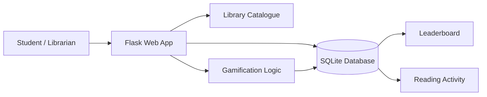
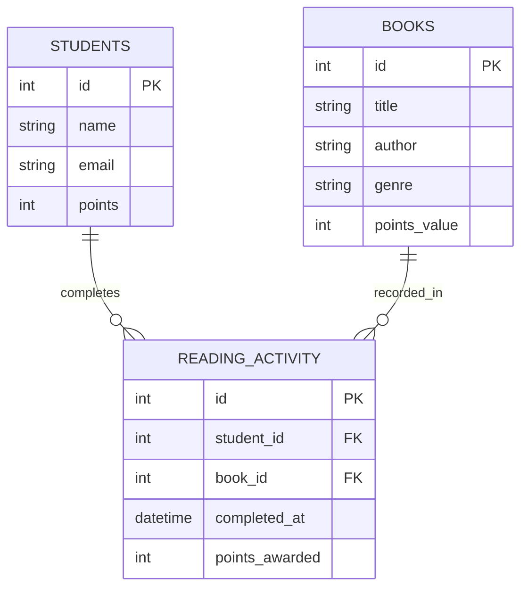

# Architecture

## System overview

## Data model

## Main workflow
1. User opens the dashboard.
2. Flask reads books, students and recent activity from SQLite.
3. User selects a student and completed book.
4. The application validates both records.
5. The book's point value is written to `reading_activity`.
6. The student's cumulative points are updated.
7. The leaderboard refreshes using database totals.

## Design decisions
- Flask keeps the prototype small and understandable.
- SQLite makes the project runnable without external infrastructure.
- A separate activity table preserves a history of completed reading rather than storing only totals.
- Point values are stored on books, allowing differentiated rewards.
